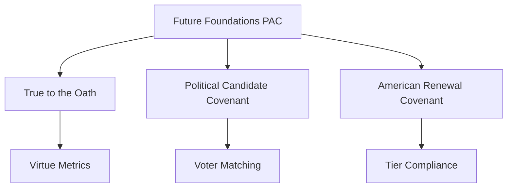

# Future Foundations PAC

**Civic covenant and institutional integrity platform**

*Preserving democratic accountability through oath-bound reforms, candidate assessment, and covenant fellowship — not commercial contracts among corporate entities.*

> **MAGGie Pro** and **ARTI Scale** are separate standalone products. See [SEPARATION.md](./SEPARATION.md).

## Mission

Future Foundations PAC organizes citizens and candidates through **covenant** — voluntary, solemn mutual obligations among free persons. The platform supports True to the Oath, the Political Candidate Covenant, and the American Renewal Covenant.

## Project Ecosystem

### Core Architecture



### Project Components

#### True to the Oath

Institutional integrity and accountability framework:

- Oath assessment systems
- Virtue metrics tracking
- Transparency portals
- Accountability chains

#### Political Candidate Covenant

Candidate assessment and voter matching system:

- Candidate profiling and integrity scoring
- Policy alignment analysis
- Voter-candidate matching algorithms
- Electoral analytics

#### American Renewal Covenant

Tiered reform commitments with measurable outcomes and covenant-bound accountability.

## Technical Architecture

### Database Schema

- Relational structure for candidates, oath assessments, and shared PAC metrics
- JSONB fields for flexible policy and virtue data
- Cross-program coordination via shared metrics and feedback loops

### API Design

- RESTful endpoints for health, metrics, and persona selection
- Persona selection for TTO / PCC governance contexts
- Agency preservation scoring for AI-assisted civic tools

## Quick Start

### Prerequisites

- Node.js 18+
- Netlify CLI
- Git

### Installation

```bash
git clone <your-repo-url>
cd FutureFoundations
npm install
netlify login
netlify link
netlify dev
```

### Database Setup

```bash
npm run db:migrate
```

Visit `http://localhost:8888` to verify the site and API.

## API Documentation

### Core Endpoints

#### Health Check

```bash
GET /api/health
```

#### Shared Metrics

```bash
GET /api/metrics
```

#### Candidate Management

```bash
POST /api/candidates
PUT /api/candidates/{id}/scores
GET /api/candidates?election_cycle=2024
```

#### Persona Selection

```bash
POST /api/persona
# Body: { project_context, user_context, interaction_type }
```

## Persona Selection Matrix

| Project Context | Interaction Type | Recommended Persona |
|-----------------|------------------|---------------------|
| TTO / PCC | Governance | Institutional-Professional |
| Cross-Project | Integration | Adaptive-Hybrid |

## Privacy & Security

- K-anonymity protection in aggregated analytics
- Human-in-the-loop for critical civic decisions
- Transparency mandates for AI-assisted tools
- Data minimization throughout

## Shared Metrics

- **Institutional Integrity Rating** — trust and accountability
- **Covenant Compliance Index** — renewal covenant tier adherence
- **Positive-Sum Indicator** — win-win outcomes across PAC programs

## Deployment

See [deployment_md.md](./deployment_md.md) for deployment instructions.

## Related Products (external)

| Product | Location |
|---------|----------|
| MAGGie Pro | `S:/projects/MAGGie/pro/` |
| ARTI Scale | `S:/projects/ARTI Scale/` |

## Project Structure

```
FutureFoundations/
├── netlify/functions/     # API and serverless
├── utils/database.js      # PAC database utilities
├── public/                # Site (home, donate, TTO)
├── research/              # Civic discussion papers
├── schema.sql             # PAC database schema
├── SEPARATION.md          # Product boundary documentation
└── netlify.toml
```

## License

MIT License — See LICENSE file for details.

---

**"Covenant among citizens — not contract among corporations."**
